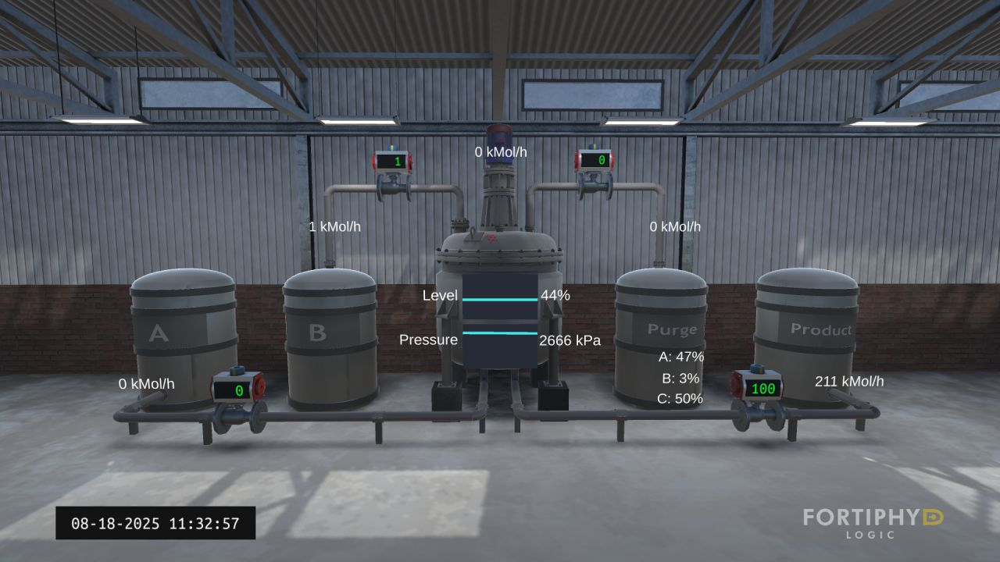
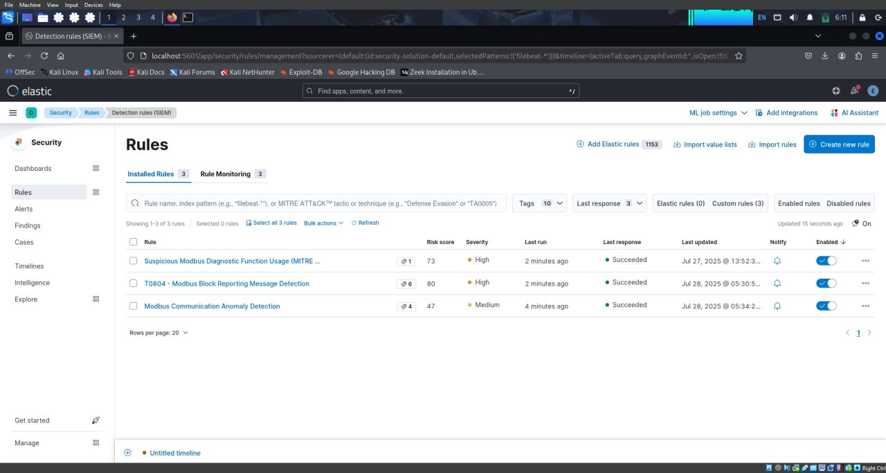
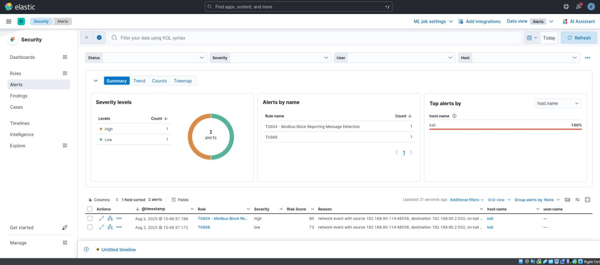
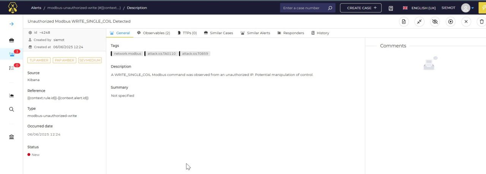
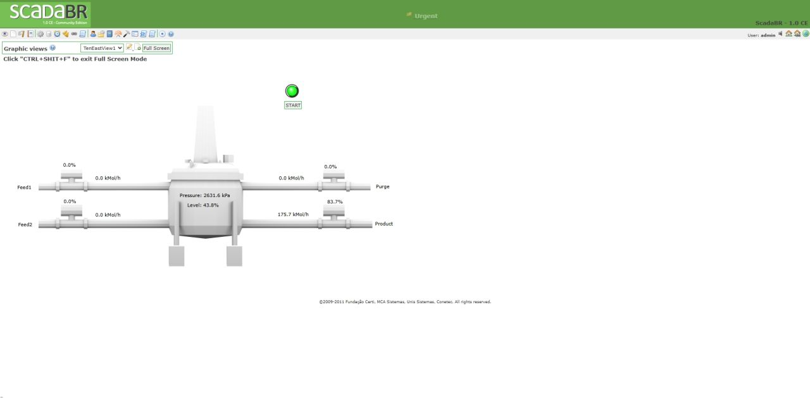
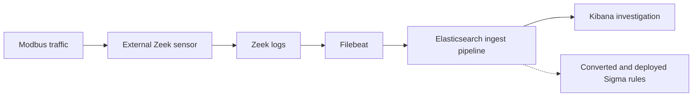

# Modbus Security Monitoring Lab

**Zeek traffic analysis and Elastic dashboards for investigating industrial network activity.**

An industrial security lab developed in **2025**, exploring Modbus traffic
monitoring, communication baselines and alert investigation. The screenshots
below document the process simulation, custom Elastic detection rules, generated
alerts and a TheHive alert from the original lab environment.

The repository preserves an Elastic Stack Compose configuration, a Filebeat
example and experimental Sigma rules. It is a partial archive of that environment;
the screenshots document work beyond the configuration files included here.

## What the project demonstrates

- **Industrial context:** relate network activity to a simulated process with
  observable valve states, pressure, level and flow readings.
- **Detection engineering:** configure custom rules around expected Modbus
  communications and protocol activity.
- **Security monitoring:** surface matching network events as Elastic alerts
  with rule names, severity and source/destination context.
- **Investigation handoff:** present an unauthorized Modbus write as a TheHive
  alert with a description, tags and observables.

## Lab in pictures

### Industrial process simulation



The simulated industrial process gives the monitoring work operational context:
valve states and process measurements help explain why unexpected control
commands matter.

### Custom Modbus detection rules



Elastic lists three enabled custom rules covering diagnostic function usage,
reporting-message anomalies and communication-baseline deviations, with
successful execution status visible for all three.

### Alerts surfaced in Elastic



The alert view shows two Modbus-related alerts, including a reporting-message
rule and a rule labeled T0888. Source and destination details are available for
investigation alongside severity and risk scores.

### Unauthorized write investigated in TheHive



TheHive displays an alert titled **Unauthorized Modbus WRITE_SINGLE_COIL Detected**,
with a description of the unexpected source, ICS tags and two observables. The
alert brings the network finding into an analyst’s investigation workflow.

<details>
<summary>Additional process view: ScadaBR</summary>



The ScadaBR view shows process feeds, valve positions, pressure and level in a
second operator interface.

</details>

These captures come from different sessions in the 2025 lab. They illustrate
individual stages, rather than one continuously recorded incident or a benchmark.

## Monitoring architecture



Zeek and Filebeat are not services in the supplied Compose file. The checked-in
Filebeat example outputs directly to Elasticsearch; the Compose file also
declares Logstash, whose referenced configuration is not included.

## Repository contents

| Path | Purpose |
|---|---|
| [docker-compose.yml](docker-compose.yml) | Elasticsearch, Kibana, setup and Logstash service definitions |
| [configs/filebeat/filebeat.yml](configs/filebeat/filebeat.yml) | Example log input and Elasticsearch output |
| [Sigma/](Sigma/) | Three experimental rule definitions |
| [docs/screenshots/](docs/screenshots/) | Captures from the original lab environment |
| [docs/SETUP.md](docs/SETUP.md), [docs/KIBANA.md](docs/KIBANA.md) | Reserved guides; their files are empty |

## Detection work

The rule files explore:

- Communication outside a configured source/destination/read-function baseline.
- Reporting-message anomalies, labeled T0804 in the rule file.
- Unusual sources, destinations and function codes, labeled T0888 in the rule file.

These are experimental definitions, not proof that the corresponding ATT&CK
behaviors are reliably detected. The current rules use lab-specific addresses
and fields. Some use strings beginning with `!` as if they were negation; those
must be reviewed and rewritten with supported Sigma conditions before use.
Rule conversion and execution in Elastic are separate deployment steps.

## Reproducing the archived environment

The captures show a running environment; the checked-in configuration does not
include every component used there. In particular, TheHive integration is shown
in a screenshot but its deployment and connector configuration are not supplied.

Prerequisites: Docker Compose, an external Zeek sensor, Filebeat, and authorized
Modbus traffic or a suitable packet capture. Elastic images in the supplied
Compose file are pinned to version 8.11.0.

Before attempting a deployment:

1. Replace password placeholders consistently and review the published ports.
   The current Elastic HTTP transport has TLS disabled; use an isolated lab.
2. Supply the missing `logstash/config/logstash.yml` and `logstash/pipeline/`
   paths if using the declared Logstash service, or adapt the service topology.
3. Configure Zeek capture and select a log format and field mapping compatible
   with the ingestion pipeline and detection rules.
4. Enable the Filebeat input: it is currently `enabled: false`. Correct the log
   paths, which currently lack a leading `/`, for your Zeek installation.
5. Create or replace the referenced `modbus_field_mapper` ingest pipeline; its
   definition is not included in this checkout.
6. Convert and deploy reviewed Sigma rules, then configure Kibana data views.

After supplying those missing pieces, configuration and service checks include:

```bash
docker compose config --quiet
docker compose up -d
docker compose ps
```

Passing Compose validation does not check missing application configuration,
log parsing or detection behavior.

## Validation checklist

Use known benign and deliberately anomalous traffic in the lab. Record:

- Whether Zeek emits the expected connection and Modbus events.
- Whether Filebeat publishes them and the ingest pipeline preserves typed fields.
- Whether Kibana displays the expected source, destination and function values.
- Whether the deployed baseline rule matches the anomalous events and excludes
  the selected normal traffic.

No automated end-to-end test, replayable traffic fixture or saved dashboard
export is included in this archive. The screenshots provide historical visual
evidence; reproducibility requires the additional configuration described above.

## Archive limitations

- Zeek configuration and the ingest pipeline are not included.
- Setup and Kibana guide files are empty.
- Experimental Sigma definitions need correction and validation before reuse.
- The original traffic fixtures and TheHive connector are not included.

## Author and license

[Nizar Yartaoui](https://github.com/nizaryart) · ENSA Fès.
See [LICENSE](LICENSE).
